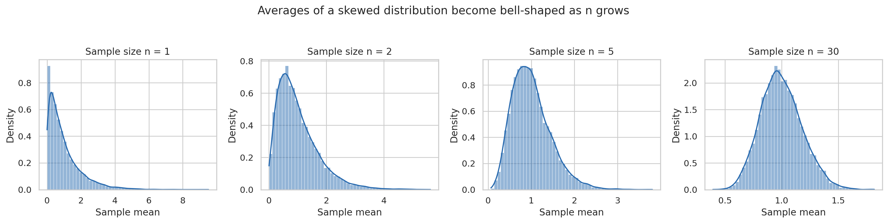
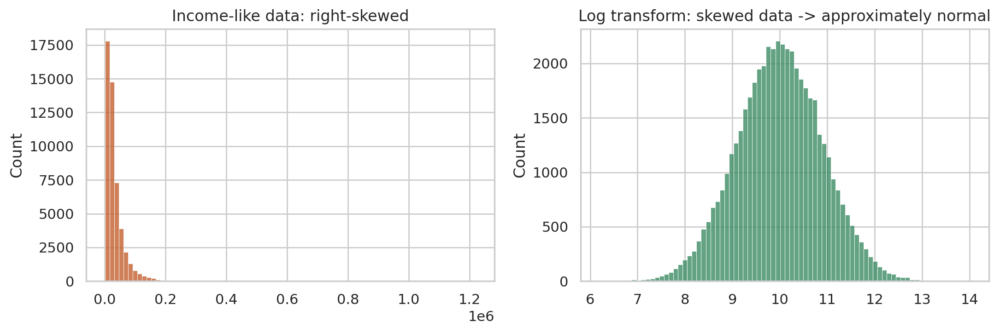

# Central Limit Theorem Simulation

A Python simulation that shows how the **sample means** of a heavily skewed distribution become approximately bell-shaped (normal) as the sample size grows.

## Problem

The Central Limit Theorem (CLT) says that the distribution of sample means approaches a normal distribution as the sample size `n` increases, even when the original data is not normal. This project demonstrates it visually.

## Approach

1. Draw 10,000 samples from an **exponential distribution** (right-skewed).
2. Compute the mean of each sample for `n = 1, 2, 5, 30`.
3. Plot the histogram and KDE of the sample means for each `n`.
4. Show a separate example of skewed, income-like (log-normal) data and how a **log transform** makes it approximately normal. This is a transformation, not the CLT.

## Results



At `n = 1` the shape is the original skewed distribution. By `n = 30` the sample means are close to a bell curve.



## Tech Stack

Python, NumPy, Seaborn, Matplotlib

## How to Run

```bash
pip install -r requirements.txt
python clt_simulation.py
```

The script saves both images in the project folder.

## Note

In `np.random.Generator.lognormal`, the `mean` parameter is the mean of the **log** of the data, not the mean of the data itself.

## Author

Ramesht Vikram, Data Science student at IIT Patna
